# atlasforge

`atlasforge` is a Go module for 2D texture atlas packing
(sprite sheet generation).
It packs many small images into one larger atlas image
and returns layout metadata with exact rectangle coordinates.

The package is built around deterministic MaxRects packing,
so repeated runs with the same input produce the same layout.
It supports multiple placement heuristics, optional 90-degree rotation,
standalone planning (`Plan`),
atlas rendering from existing layout (`Render`),
and a one-shot end-to-end flow (`Pack`).

It is useful for game asset pipelines, UI icon atlases,
build-time resource packing, and any workflow
where you need predictable atlas output plus JSON friendly placement data
(`id`, `x`, `y`, `width`, `height`, `rotated`).

## Install

```bash
go install github.com/woozymasta/atlasforge
```

## Packing Examples

Below are examples of how different heuristics pack the same kind of sprite set.

### Best Short Side Fit (BSSF)

<!-- markdownlint-disable-next-line MD033 -->
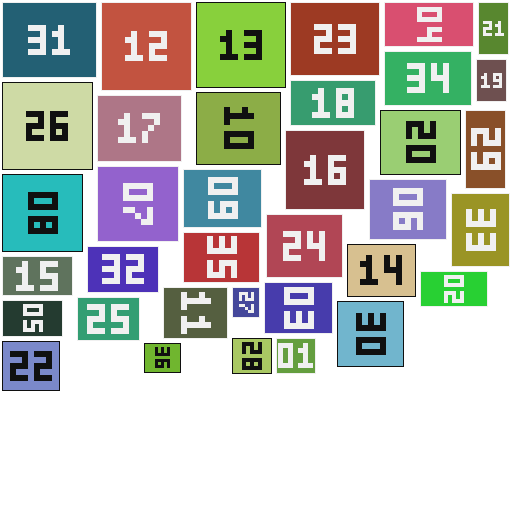

`HeuristicBestShortSideFit` chooses a position
where the short leftover edge is as small as possible.
In practice this gives a stable and predictable packing style,
where rectangles usually sit tightly without creating
too many thin unusable gaps near each other.

This heuristic is often used as a safe baseline
when you need reasonable quality without tuning.
It is usually not the top performer in pure speed,
but it behaves consistently across different sprite sets
and keeps resource usage around the middle of the pack.

<!-- markdownlint-disable-next-line MD033 -->
<br clear="right"/>

### Best Long Side Fit (BLSF)

<!-- markdownlint-disable-next-line MD033 -->
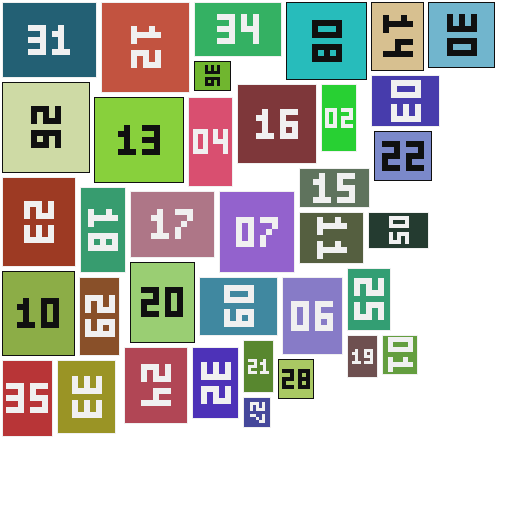

`HeuristicBestLongSideFit` minimizes the larger leftover edge,
so it tries to avoid creating very large open strips after every placement.
This often keeps free space in shapes
that remain useful for upcoming rectangles.

In everyday workloads this mode is one of the fastest
among the quality-oriented heuristics.
It is a strong choice when you still care about packing quality,
but you also want quick planning and a practical balance
between speed and memory cost.

<!-- markdownlint-disable-next-line MD033 -->
<br clear="right"/>

### Best Area Fit (BAF)

<!-- markdownlint-disable-next-line MD033 -->
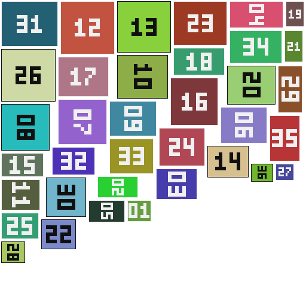

`HeuristicBestAreaFit`
focuses on minimizing wasted area in candidate free rectangles.
Instead of looking only at one edge,
it evaluates how much surface would be lost
after placement and picks the option with lower area waste.

Because of this behavior it often produces
visually compact results close to BLSF.
Performance is usually in the same range, sometimes a bit slower,
but still in the efficient group for production packing pipelines.

<!-- markdownlint-disable-next-line MD033 -->
<br clear="right"/>

### Bottom Left (BL)

<!-- markdownlint-disable-next-line MD033 -->
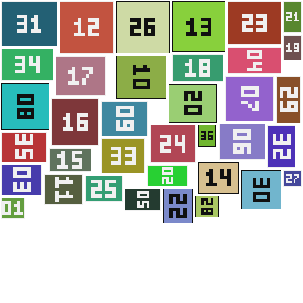

`HeuristicBottomLeft` follows a simple geometric rule:
lowest possible `Y`, then lowest possible `X`.
This makes the behavior easy to reason about when debugging layouts,
because placements look naturally layered
from bottom to top and from left to right.

The tradeoff is speed.
In most benchmark scenarios this mode is the slowest for planning and packing,
while memory usage stays around average.
It can still be useful when deterministic bottom-left style placement
is preferred over raw throughput.

<!-- markdownlint-disable-next-line MD033 -->
<br clear="right"/>

### Contact Point (CP)

<!-- markdownlint-disable-next-line MD033 -->
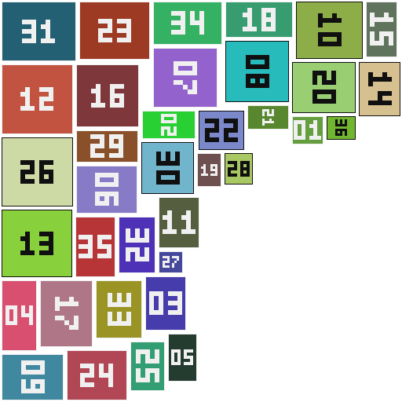

`HeuristicContactPoint` tries to maximize border contact
with already placed rectangles and atlas edges.
The intuition is to grow packed clusters
by touching existing geometry as much as possible,
which can reduce scattered islands of free space.

This mode often yields compact, visually dense packing,
but it usually runs slower than BLSF and BAF.
At the same time it tends to be relatively light on allocations
among quality-focused heuristics, so it can be attractive
when packing compactness is more important than peak speed.

<!-- markdownlint-disable-next-line MD033 -->
<br clear="right"/>

### First Fit (FF)

<!-- markdownlint-disable-next-line MD033 -->
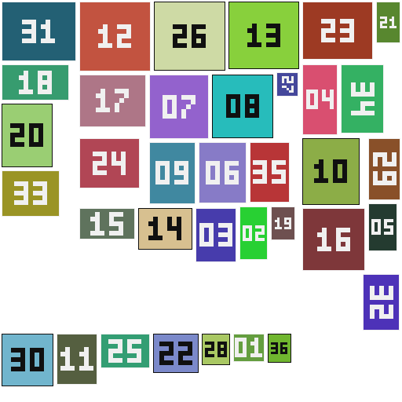

`HeuristicFirstFit` takes the first free rectangle
that can accept the item and moves on immediately.
It avoids expensive candidate scoring
and minimizes decision overhead during planning.

This is the fastest option by a wide margin
and works very well for preview generation, rapid iteration,
and high-throughput batch jobs.
The main tradeoff is higher memory footprint compared
to most quality-oriented modes,
so it is best when throughput is the top priority.

<!-- markdownlint-disable-next-line MD033 -->
<br clear="right"/>

## Options

Configure packing with `Options`, usually starting from `DefaultOptions()`.
The examples below show the options
that change rendered pixels or output structure;
the remaining settings control size search and placement.

### Minimum atlas size

`MinSize` sets the smallest candidate size for either atlas side.
The resulting atlas will not be smaller than this value.

### Maximum atlas size

`MaxSize` sets the largest candidate size for either atlas side.
`Plan` and `Pack` return an error if all items do not fit;
page APIs start another page when needed,
but return an error if one item cannot fit by itself.

### Sprite padding

`Padding` reserves this many empty pixels around each sprite.
It increases each packed rectangle by twice the padding value
in both dimensions and can reduce packing density.
The extrusion example shows a wide padding area
before and after its pixels are filled.

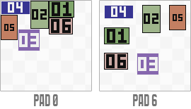

### Edge extrusion

`Extrude` copies sprite edge pixels outward into the reserved padding.
Set it from `0` to `Padding`;
this helps prevent texture filtering from sampling neighboring sprites.
The image compares padding alone with padding filled by extrusion.


### Atlas shape preference

`AspectPenalty` biases candidate selection toward less elongated atlases.
`0` disables the bias; `DefaultOptions()` uses `0.25`.
`HeuristicFirstFit` ignores this setting.

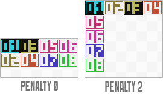

### Placement heuristic

`Heuristic` selects the placement scoring strategy.
See the six heuristic examples above for the visual differences and tradeoffs.

### Prefer taller atlases

`PreferHeight` breaks candidate-selection ties in favor of taller layouts.
It can also affect which candidate is tried first with `HeuristicFirstFit`.

### Square atlases

`ForceSquare` restricts candidates to equal width and height.
Leave it disabled when rectangular atlases
are acceptable and lower area is preferred.

### Sprite rotation

`AllowRotate` lets a sprite rotate 90 degrees clockwise when that helps it fit.
The resulting `Placement` records this with `rotated: true`.

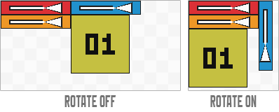

### Transparent bounds trimming

`TrimTransparent` excludes fully transparent outer pixels
from packing in image-based APIs
while preserving each sprite's crop offset in the layout.
The example shows the original canvases and the compacted atlas.

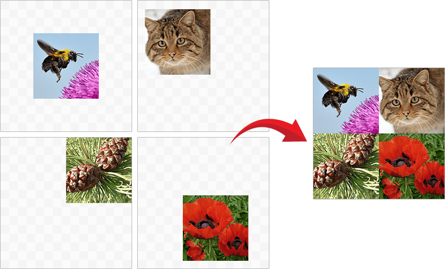

### Exact color key

`ColorKey` can exclude exact color matches from trim bounds with `Trim`,
replace them with transparent pixels with `ToAlpha`, or do both.
Matching uses the renderer's canonical RGBA8 pixel, including alpha;
anti-aliased shades do not match.
It affects image-based packing and rendering, not geometry-only `Plan` APIs.

```go
opts.ColorKey = &atlasforge.ColorKeyOptions{
    Color:   color.NRGBA{R: 255, G: 255, B: 255, A: 255},
    Trim:    true,
    ToAlpha: true,
}
```

### Duplicate sprite reuse

`Deduplicate` stores identical rendered pixels once
in image-based APIs and maps duplicate IDs to that placement.
Alias entries remain in the layout.
The example shows duplicate inputs
before and after sharing their packed rectangles.

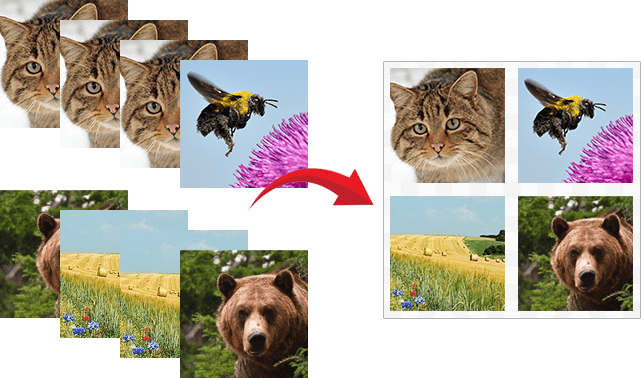

### Multi-page packing

`PlanPages`, `PackPages`, and `BuildPages` split inputs
across atlases when they do not fit together.
Each page is compacted within the configured size bounds.
This is an API mode, not an `Options` field.

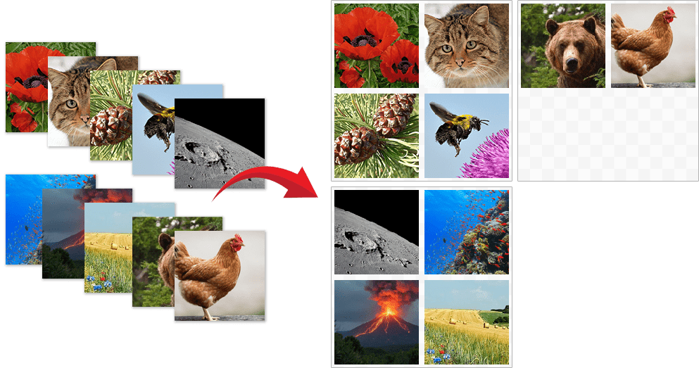

## Practical Example

The example below shows a practical flow: read source files from disk,
pack them into one atlas image, save `atlas.png`,
and save placement metadata to `atlas-layout.json`.

```go
package main

import (
    "encoding/json"
    "image/png"
    "os"
    "path/filepath"

    "github.com/woozymasta/atlasforge"
)

func main() {
    // Collect source image files.
    files := []string{
        "assets/icons/ok.png",
        "assets/icons/warn.png",
        "assets/icons/error.png",
    }

    // Decode files and convert them into atlasforge sprites.
    sprites := make([]atlasforge.Sprite, 0, len(files))
    for _, path := range files {
        file, err := os.Open(path)
        if err != nil {
            panic(err)
        }

        img, err := png.Decode(file)
        file.Close()
        if err != nil {
            panic(err)
        }

        sprites = append(sprites, atlasforge.Sprite{
            ID:    filepath.ToSlash(path),
            Image: img,
        })
    }

    // Run packing and get atlas image + layout metadata.
    opts := atlasforge.DefaultOptions()
    opts.Padding = 2

    atlas, err := atlasforge.Pack(sprites, opts)
    if err != nil {
        panic(err)
    }

    // Save atlas image as PNG.
    atlasFile, err := os.Create("atlas.png")
    if err != nil {
        panic(err)
    }

    if err := png.Encode(atlasFile, atlas.Image); err != nil {
        atlasFile.Close()
        panic(err)
    }
    if err := atlasFile.Close(); err != nil {
        panic(err)
    }

    // Save atlas layout as formatted JSON.
    layoutFile, err := os.Create("atlas-layout.json")
    if err != nil {
        panic(err)
    }
    enc := json.NewEncoder(layoutFile)
    enc.SetIndent("", "  ")
    if err := enc.Encode(atlas.Layout); err != nil {
        layoutFile.Close()
        panic(err)
    }
    if err := layoutFile.Close(); err != nil {
        panic(err)
    }
}
```

`atlas-layout.json` will look like this:

```json
{
  "placements": [
    {
      "id": "assets/icons/ok.png",
      "x": 2,
      "y": 2,
      "width": 32,
      "height": 32,
      "rotated": false
    },
    {
      "id": "assets/icons/warn.png",
      "x": 40,
      "y": 2,
      "width": 48,
      "height": 24,
      "rotated": true
    }
  ],
  "width": 256,
  "height": 256
}
```

In placement entries, `rotated: true` means the source sprite
was placed with a `+90` degree clockwise rotation in the atlas.
`width` and `height` store original sprite dimensions before rotation.
